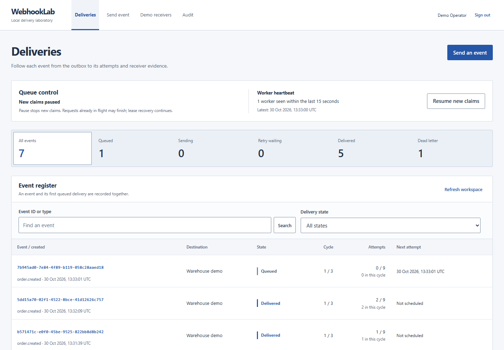

# WebhookLab

Send synthetic webhook events, inject receiver failures, and inspect every delivery attempt alongside the receiver's evidence.

WebhookLab is a local integration laboratory built with a Next.js static frontend, a Go API, a separate Go worker and demo receiver, and PostgreSQL 17. It demonstrates durable event creation, retries, lease recovery, and receiver deduplication. A request can time out after the receiver has already recorded its effect, so delivery status and receiver evidence are shown separately.



## What the lab demonstrates

- An event and its queued delivery commit together in a PostgreSQL outbox transaction.
- A worker records an attempt, releases its database transaction, then sends HTTP. Lease fencing prevents an old worker from overwriting newer work.
- Failed requests retry after 2 seconds and then 5 seconds, with 3 attempts per cycle. Two explicit redrives allow at most 9 attempts while preserving history.
- HMAC authenticates the exact immutable envelope. The local receiver records one synthetic effect per event and destination, even when it receives duplicates.
- Queue pause stops new claims. Requests already in progress may finish, and expired leases still recover.

The worker can send the same event more than once. Its finite retry budget can end in `DEAD_LETTER`, so eventual delivery is not guaranteed. The one-effect behavior belongs to the local receiver's deduplication transaction; it is not a guarantee about an arbitrary remote system. The [architecture](docs/ARCHITECTURE.md) explains that distinction.

## Start locally on Windows

Install Docker Desktop with Compose, start its Linux container engine, then run PowerShell from this repository:

```powershell
.\scripts\Init.ps1
.\scripts\Start.ps1
```

Open exactly [127.0.0.1:8097](http://127.0.0.1:8097). Sign in as `operator@webhooklab.test` with the generated password in `.local/LOCAL-CREDENTIALS.txt`. Git ignores this credential file and the private `.env`. The password is never prefilled in the form, and restarting does not reset existing accounts or event data.

The UI is a static Next.js export served by Nginx. The API, worker, receiver, and database run as separate Compose services. Destinations are fixed to two local demo endpoints. No external payment or email service is contacted.

## Try three outcomes

1. Keep a demo receiver in **Healthy** mode and send an `order.created` event with a synthetic JSON object, for example `{"orderId":"DEMO-1001","source":"synthetic"}`. Inspect the successful attempt and receipt.
2. Set a receiver to **Return 503** (`FAIL`), send another event, and inspect its three failed attempts and `DEAD_LETTER` state. Switch to Healthy, then redrive with an explanatory note.
3. Set a receiver to **Apply, then delay** (`TIMEOUT`) and send a new event. The receiver records its effect before delaying its response beyond the worker's timeout. Inspect the unknown sender outcome and the separate receipt with one effect. After switching to Healthy, redrive the dead-letter event and inspect the duplicate receipt.

Use a new event for each scenario. Receiver modes are shared workspace controls, so changing a mode also affects other pending deliveries to that destination. Pause the queue to stop new claims while inspecting work; a request already in flight can still complete.

## Inspect and verify

```powershell
.\scripts\Test.ps1
.\scripts\Stop.ps1
```

Native verification uses an isolated test database. Browser checks are optional and use the running local application; see [operations](docs/OPERATIONS.md) before running them. The [verification record](docs/VERIFICATION.md) contains actual commands, observations, and any limitations for the delivered checkout.

| View | Actual capture |
| --- | --- |
| Sign in | [Login screen](docs/screenshots/01-login.png) |
| Delivery register | [Events and queue state](docs/screenshots/02-deliveries.png) |
| Delivery evidence | [Attempts and receiver receipt](docs/screenshots/03-event-detail.png) |
| Narrow screen | [Mobile layout](docs/screenshots/04-mobile.png) |

## Read the implementation

| Document | Purpose |
| --- | --- |
| [Architecture](docs/ARCHITECTURE.md) | Outbox, claims, leases, fencing, retry budgets, signing, and unknown outcomes |
| [API](docs/API.md) | Routes, payloads, sessions, controls, and error behavior |
| [Operations](docs/OPERATIONS.md) | Start, stop, verification, configuration, and local recovery |
| [Code guide, Bahasa Indonesia](docs/CODE-GUIDE.md) | Start-to-source walkthrough with file responsibilities and request data flow |
| [Interview notes, Bahasa Indonesia](docs/INTERVIEW.md) | Explain the decisions, demonstrate failures, and state the boundaries |
| [Implementation contract](docs/CONTRACT.md) | Shared HTTP, persistence, timing, and frontend rules |
| [UI review](docs/UX-REVIEW.md) | Recorded control, keyboard, contrast and responsive checks |

The workspace accepts at most 500 events, with bounded payloads and attempt history. It has one synthetic operator account and two fixed destinations. Use the recorded tests and recovery evidence to assess this local lab; it does not implement real order processing or a general webhook hosting service.
