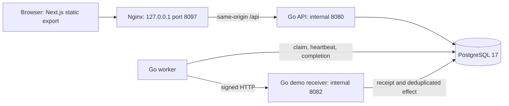
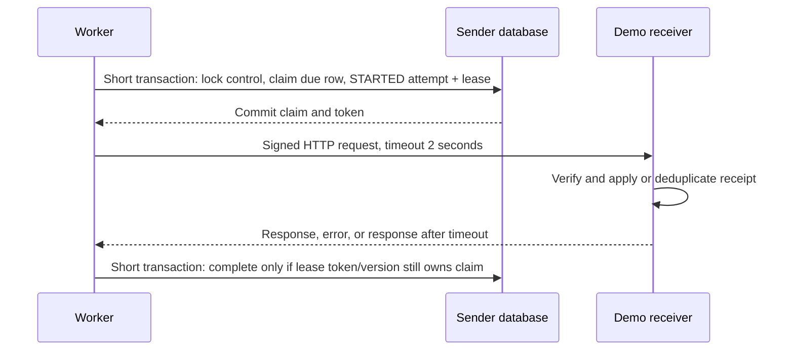
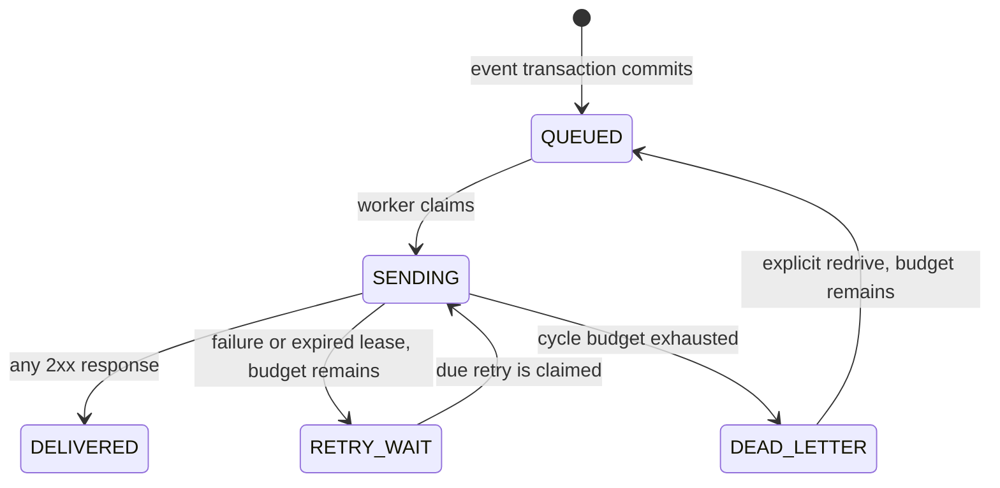

# Architecture

WebhookLab separates the sender's knowledge from the receiver's evidence. It stores an immutable event, allows repeated delivery attempts within a finite retry budget, and lets an operator inspect what happened when a request succeeds, fails, times out, or loses its worker.

Every event and receiver effect is synthetic. The receiver records a receipt; it does not create an order, cancel an order, charge a customer, or contact an external provider.

## Runtime boundaries

Next.js builds static assets. Nginx serves them and proxies API requests; it does not run Next.js server rendering or server actions. The Go API handles sessions, event creation, queries, versioned controls, and redrives. A separate worker performs delivery, while a separate receiver verifies requests and records receipts.

The local stack uses one PostgreSQL server, with distinct records and transactions for sender and receiver responsibilities. Sharing this database makes receiver evidence observable in the lab. It does not mean a sender normally has access to another organization's receipt table.

## Durable outbox and immutable bytes

Create accepts a fixed destination, a supported event type, and a JSON object supplied as text. The service validates the object and compacts whitespace without converting arbitrary JSON numbers into floating-point values. It creates an envelope containing the event ID, type, creation time, and original object. That envelope's stored bytes are immutable and become the signing and delivery input.

The event and initial `QUEUED` delivery commit in one transaction. A worker can therefore only discover committed work. There is no interval in which the API reports a durable event while forgetting to enqueue its initial delivery.

A mandatory actor-scoped UUID idempotency key identifies create requests. A replay with the same destination, event type, and compact payload returns the current existing delivery. Reusing the key with different content returns `409`. The fingerprint includes unambiguous boundaries between values. A singleton lock protects the 500-event workspace cap, while committed retries remain available at capacity.

## Claim, send, and complete

A claim uses row locks and `SKIP LOCKED`. It stores a `STARTED` attempt and a 10-second lease before network I/O. The HTTP request runs after commit; no database transaction stays open while waiting for the receiver.

A completion must still own the lease token and expected delivery version. The service first acquires the delivery row lock, then checks lease expiry against the current database clock in a separate statement. Waiting for a lock must not preserve an earlier, still-valid view of time. If the lease has expired or a newer claim owns the row, the old completion is fenced out. Fencing protects sender state. It cannot undo an HTTP request or a remote effect that already happened.

PostgreSQL distinguishes transaction-start timestamps from its current clock. That distinction matters when a transaction waits on a lock before checking a deadline. [PostgreSQL date/time documentation](https://www.postgresql.org/docs/17/functions-datetime.html#FUNCTIONS-DATETIME-CURRENT).

Expired leases turn unfinished `STARTED` attempts into `ABANDONED` attempts with an unknown outcome. Recovery sets `finishedAt` to its database statement time and computes `durationMs` from attempt start to that recovery time. This interval includes waiting for lease recovery; it is not an HTTP response duration and can exceed the two-second request timeout. Recovery either schedules another attempt or exhausts the budget into `DEAD_LETTER`. Recovery continues even when new claims are paused.

## Retry budget and workflow

One cycle allows three attempts. Failed attempt 1 becomes due after 2 seconds; failed attempt 2 becomes due after 5 seconds. Any known HTTP 2xx is success even if reading its bounded response preview fails; the preview is best-effort evidence. Other HTTP responses, timeout, or network error consume the same budget. These are retry due times, not promises of exact wall-clock completion under load.

An operator can redrive a dead-letter event at most twice. Redrive requires an expected version and a note of 10 to 500 Unicode code points after trimming. It starts a new cycle while retaining previous attempts and receipts. The attempt number keeps growing across cycles, with at most nine attempts per event. Concurrent or stale redrives receive `409`.

Attempt statuses are `STARTED`, `SUCCEEDED`, `HTTP_ERROR`, `TIMEOUT`, `NETWORK_ERROR`, and `ABANDONED`. Stored response previews are bounded to 2,048 bytes and rendered as text. Safe error categories describe failure classes without exposing authentication headers or internal network errors.

## Why timeout does not mean no effect

The receiver modes deliberately separate response behavior from effect persistence:

| Mode | Receiver behavior | Sender observation |
| --- | --- | --- |
| `HEALTHY` | Verify, commit receipt/effect or duplicate count, respond immediately | Normally a successful attempt |
| `FAIL` | Verify, return 503 without an effect | HTTP error, then retry or dead letter |
| `TIMEOUT` | Verify, commit receipt/effect, wait 3.5 seconds before responding | Worker times out after 2 seconds; remote outcome remains unknown to sender |

In Timeout mode, retries can reach the receiver again after the first effect committed. The receiver increments `receiptCount` for duplicates but keeps `effectCount` at one. Switching to Healthy and redriving can therefore deliver a successful response for an already applied event.

The lab uses at-least-once attempt semantics: the same event may reach a receiver more than once. Its finite retry policy can exhaust all three cycles into `DEAD_LETTER`; it does not guarantee eventual successful delivery or exactly-once HTTP delivery. A sender timeout, a lost response, or an abandoned lease cannot establish whether an arbitrary receiver applied an effect. The UI exposes the local receipt as separate evidence instead of treating a timeout as proof of non-processing.

## HMAC and receiver deduplication

Destinations are fixed: `warehouse` and `billing`, with relative routes `/hooks/warehouse` and `/hooks/billing`. Users cannot submit a destination host or URL. The trusted receiver base URL and master signing secret come from deployment configuration.

For each destination, derive a key using HMAC-SHA256 over its destination ID with the master secret. Sign timestamp, event ID, and exact stored envelope bytes, separated by periods, using the raw derived key bytes. Requests carry `Webhook-Id`, `Webhook-Timestamp`, and `Webhook-Signature: v1=<hex>`.

The receiver checks body size, event/envelope ID agreement, a 300-second timestamp tolerance, and the signature with constant-time comparison before persistence. A unique destination/event key and a transaction coordinate concurrent duplicates. The same key with a different body hash returns `409`. A first receipt records one synthetic effect; later identical receipts increment the receipt count. No secret or actual signature is returned in the UI or recorded in audit notes.

## Pause, heartbeat, and audit

Queue pause and claims use a shared control-row lock. After a pause commits, later claims see the paused state. Claims that already committed are in flight and may finish. Pause does not cancel those requests or prevent expired-lease recovery.

Workers heartbeat every three seconds. The dashboard reports active count and last-seen time using the database clock and a 15-second stale threshold. A recent heartbeat is evidence that a worker was seen recently; it does not guarantee that the next request will complete. Heartbeat continues while paused.

Create, claim, completion, recovery, redrive, and control changes append audit events in the same transaction as their corresponding state transition. The API provides no audit edit or delete route. This is application-level history, not protection against a database administrator changing storage.

## Session and deployment limits

The single local operator has a BCrypt password hash and an opaque 12-hour session. PostgreSQL stores the session token's SHA256 digest. Mutations require the exact browser origin and CSRF token. Only exact public health and login routes bypass session checks; receiver hooks use HMAC rather than browser sessions.

Login throttling uses the API's immediate remote peer. In the supplied Nginx deployment, browser users share the reverse proxy's throttle scope. This is a local-workspace limit, not a per-person rate-limiting service.

The current version has a 500-event capacity, bounded payloads, two fixed destinations, and one workspace operator. Multiple workers must coordinate safely, even though the local Compose stack defaults to one. Arbitrary public endpoints, organization isolation, external secret distribution, retention automation, and production operating procedures are outside this local lab.
