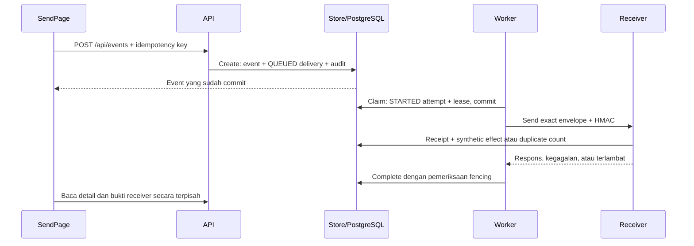

# Panduan kode dari nol sampai aplikasi berjalan

WebhookLab adalah lab webhook lokal dengan data sintetis. Ikuti satu event dari form, transaksi outbox, claim worker, request HMAC, sampai receipt receiver. Setelah itu, ulangi dengan kegagalan dan timeout agar hubungan antara kode dan bukti tersimpan terlihat.

## 1. Menjalankan aplikasi

Aktifkan Docker Desktop dengan Linux containers. Buka PowerShell di direktori yang berisi `compose.yml`, `backend/`, `frontend/`, dan `scripts/`.

```powershell
.\scripts\Init.ps1
.\scripts\Start.ps1
```

Buka `http://127.0.0.1:8097`. Gunakan akun `operator@webhooklab.test` dan password hasil inisialisasi pada `.local/LOCAL-CREDENTIALS.txt`. File itu serta `.env` privat diabaikan Git. Jangan mengganti host menjadi `localhost`, karena pemeriksaan origin menggunakan alamat yang tepat.

Start membangun image Go lalu web secara berurutan, kemudian menjalankan database, API, worker, receiver, dan Nginx. Frontend merupakan hasil static export Next.js; tidak ada proses Next.js server pada runtime ini.

```powershell
# Memakai image yang sudah ada.
.\scripts\Start.ps1 -NoBuild

# Menghentikan container, mempertahankan volume database.
.\scripts\Stop.ps1

# Pemeriksaan native dengan database test terpisah.
.\scripts\Test.ps1
```

Native Go memakai toolchain 1.27.3 dari `scripts/Go.ps1`, bukan perubahan instalasi global. Script menaruh toolchain serta cache module/build di direktori lokal proyek pada drive D dan memulihkan environment proses setelah selesai. Test frontend membutuhkan Node.js/npm. Perintah lifecycle dan isolasi test dijelaskan di [OPERATIONS.md](OPERATIONS.md); hasil yang benar-benar dijalankan berada di [VERIFICATION.md](VERIFICATION.md).

## 2. Istilah yang terlihat di layar dan kode

| Istilah | Makna dalam lab |
| --- | --- |
| Event | Identitas, destination, type, payload, waktu, dan envelope yang immutable |
| Delivery | State pengiriman untuk satu event; ID-nya sama dengan event |
| Attempt | Satu claim dan upaya HTTP; nomor terus naik lintas cycle |
| Cycle | Satu anggaran tiga attempt |
| Redrive | Keputusan operator memulai cycle baru dari dead letter, maksimal dua kali |
| Receipt | Bukti receiver lokal menerima event, termasuk jumlah duplicate |
| Effect | Satu row efek sintetis di receiver, bukan order atau pembayaran nyata |
| Outbox | Event dan delivery awal disimpan dalam satu transaksi |
| Lease | Token dan batas waktu kepemilikan kerja setelah transaksi claim selesai |
| Fencing | Menolak completion worker lama berdasarkan state, token, version, dan masa lease |

State sender dan bukti receiver dapat berbeda. Receiver mungkin sudah commit efek, sementara sender mencatat TIMEOUT karena respons tidak datang dalam batas dua detik. Karena itu, receipt tidak dipakai untuk menulis ulang attempt timeout menjadi sukses.

Semantik attempt at least once berarti event dapat dikirim berulang. Tiga attempt per cycle dan maksimal dua redrive membatasi total menjadi sembilan attempt; setelah anggaran habis, event dapat tetap DEAD_LETTER. Penyimpanan durable dan retry ini tidak menjamin pengiriman akhirnya berhasil.

## 3. Alur satu event



Browser tidak mengirim webhook langsung ke receiver. Browser meminta API mencatat event, dan worker terpisah mengambil pekerjaan yang telah commit. Request HTTP worker berlangsung setelah transaksi claim berakhir. Receiver memiliki transaksi sendiri; sender tidak dapat melakukan rollback terhadap efek yang sudah commit di sana.

## 4. Dasar membaca Go di proyek ini

`context.Context` membawa pembatalan dan deadline ke query serta request HTTP. Banyak fungsi mengembalikan nilai dan `error`; caller harus memeriksa error sebelum memakai nilainya. `defer tx.Rollback(ctx)` memastikan transaksi yang keluar lebih awal dibatalkan; sesudah commit, rollback yang ditunda tidak mengembalikan perubahan yang sudah commit.

Struct tag seperti `json:"eventType"` menentukan bentuk API. `json:"-"` menyembunyikan field internal dari JSON, misalnya session digest. `[]byte` dipakai untuk envelope serta HMAC agar identitas byte tidak bergantung pada serialisasi ulang. Goroutine heartbeat berjalan terpisah dari request worker yang mungkin menunggu receiver.

PostgreSQL digunakan melalui pgx dan parameter query. Nama tabel dan klausa SQL berasal dari kode; nilai pengguna dikirim sebagai parameter. Bentuk ini berbeda dari menempelkan search atau note langsung ke teks SQL.

## 5. Titik masuk backend

| File | Tanggung jawab |
| --- | --- |
| `backend/cmd/api/main.go` | Membuka store/migrasi, seed akun bila kosong, membuat API/auth, lalu menjalankan listener |
| `backend/cmd/worker/main.go` | Membaca secret dan receiver terpercaya, membuat worker ID, menjalankan loop; subcommand `health` memeriksa heartbeat ID lokal |
| `backend/cmd/receiver/main.go` | Membaca secret, membuka store, lalu menjalankan HTTP receiver |
| `backend/internal/lab/runtime.go` | Helper environment, koneksi runtime, secret, signal, HTTP server, dan pesan kegagalan aman |

`RuntimeStore()` meminta `WEBHOOK_DB_URL`, memanggil `Open()` dan `Migrate()`, lalu menutup pool jika migrasi gagal. `SigningSecret()` meminta sedikitnya 32 byte secret server. `Environment()` memberi fallback untuk konfigurasi nonsecret. `SignalContext()` menangkap interrupt/SIGTERM. `Serve()` memasang batas waktu HTTP dan melakukan shutdown dengan context terpisah. `ExitFailure()` mencatat pesan tetap lalu keluar; caller tidak mencetak connection string atau secret.

Worker menulis ID prosesnya ke `/tmp/worker-id`. Health command membacanya dan memeriksa `WorkerHealthy()` pada database. Dashboard juga memakai heartbeat database, tetapi tampilan hanya menyatakan kapan worker terakhir terlihat, bukan menjanjikan health menyeluruh.

## 6. Model dan skema

### `backend/internal/lab/types.go`

File ini memuat `User`, `Session`, `QueueControl`, `WorkerStatus`, `Dashboard`, `Destination`, `Delivery`, `Attempt`, `Receipt`, `AuditItem`, `DeliveryDetail`, `Page[T]`, dan `CreateInput`. Field nullable memakai pointer agar JSON dapat membedakan belum ada nilai dari angka nol.

`APIError` membawa status internal serta code/message publik. `invalid()`, `conflict()`, dan `missing()` membuat error bisnis. `apiError()` mempertahankan error yang dikenal dan mengubah error internal menjadi pesan umum. `ValidID()` memeriksa UUID berbentuk canonical, sedangkan `NewID()` memakai random kriptografis dan bit UUID v4.

### `backend/internal/lab/schema.sql`

| Tabel | Peran |
| --- | --- |
| `users`, `sessions`, `login_throttle` | Akun lokal, hash session, CSRF, expiry, dan pembatasan login |
| `workspace_guard` | Row pengunci kapasitas create dan inisialisasi akun |
| `queue_control` | Pause dan version kontrol antrean |
| `destinations` | Dua route tetap beserta mode dan version |
| `events` | Payload text dan envelope bytea yang disimpan saat create |
| `deliveries` | State, version, cycle, anggaran attempt, jadwal, dan lease |
| `idempotency_keys` | Aktor, key, fingerprint, dan event hasil commit |
| `attempts` | Nomor attempt, cycle, hasil, preview terbatas, error category, dan worker |
| `receipts` | Hash body, waktu pertama/terakhir, serta jumlah receipt per destination/event |
| `receiver_effects` | Row efek sintetis yang dibuat bersama receipt pertama |
| `workers` | Heartbeat per worker ID |
| `audit` | Aktor, aksi, waktu, event terkait, dan note |

Constraint membatasi state, cycle 1 sampai 3, redrive 0 sampai 2, serta total attempt 0 sampai 9. Unique index membatasi satu STARTED attempt per event. Token dan expiry lease wajib ada hanya pada state SENDING. Kunci unik receipt/effect mendukung deduplikasi receiver.

SQL disematkan dengan `go:embed`. `Migrate()` memakai advisory transaction lock dan tabel `schema_migrations` untuk versi awal. Migrasi terjadi pada startup, bukan request pertama. Jika skema yang sudah dipakai perlu berubah, tambahkan versi migrasi yang sesuai; mengedit SQL v1 saja tidak mengubah database yang telah mencatat versi itu.

## 7. Store dan transaksi create

### `backend/internal/lab/store.go`

| Fungsi | Alur yang dibaca |
| --- | --- |
| `Open()` | Parse konfigurasi pgx, tetapkan pool kecil dan UTC, lalu ping database |
| `Migrate()` | Lock startup, periksa versi, jalankan SQL embedded bila belum terpasang, commit |
| `Seed()` | Lock guard, hitung user, hash password BCrypt cost 12 dan insert akun hanya bila kosong |
| `audit()` | Menambahkan audit dengan transaction yang diberikan caller |
| `compactPayload()` | Batas byte/UTF-8, satu objek JSON valid, lalu `json.Compact` tanpa float64 |
| `fingerprint()` | Hash setiap bagian dengan awalan panjang agar batas nilai tidak ambigu |
| `scanDelivery()` | Memetakan hasil SQL bersama ke struct Delivery |
| `Create()` | Validasi, fingerprint, guard, replay/capacity, insert event/delivery/key/audit, commit |
| `Destinations()` | Membaca route/mode/version tetap |
| `Dashboard()` | Snapshot read-only repeatable-read untuk count, control, heartbeat, dan waktu database |
| `Events()` | Validasi page/state/search, escape wildcard, query total dan halaman terikat dalam satu snapshot read-only repeatable-read |
| `oneOf()` | Memeriksa enum kecil yang diizinkan |

Dalam `Create()`, validasi payload mendahului transaksi. Sesudah guard terkunci, service memeriksa key milik aktor. Replay identik membaca delivery yang sudah ada; konten berbeda menghasilkan konflik. Pemeriksaan key mendahului batas 500 event agar retry yang sah tetap bekerja ketika kapasitas penuh.

Envelope dibentuk dari ID, type, waktu database UTC, dan payload yang telah di-compact. Payload tidak dibaca ke map angka floating point. Event, delivery awal, key, dan audit kemudian disimpan bersama. Commit membuat event dan antrean awal durable; keberhasilan HTTP tetap bergantung pada receiver dan sisa anggaran attempt.

Search memakai substring literal ID atau event type, paling banyak 64 Unicode code point. `%`, `_`, dan escape character diperlakukan sebagai karakter pencarian, bukan kemampuan mengubah SQL. Page size tetap 25 dan urutan mempunyai ID sebagai tie-breaker.

## 8. Workflow dan kontrol

### `backend/internal/lab/workflow.go`

`Detail()` membaca delivery, semua attempt menurut nomor, receipt tujuan event, dan audit terkait dalam satu snapshot read-only repeatable-read. `Audit()` juga membaca count dan halaman dalam satu snapshot. Helper bebas `auditItems()` menerima source melalui interface `queryRows`, sehingga pembacaan audit dapat memakai transaction caller dan klausa tetap tanpa keluar dari snapshot itu. Dashboard, event list, detail, dan audit konsisten di dalam respons masing-masing; request yang berbeda tetap dapat melihat perubahan pada waktu yang berbeda.

`SetQueue()` mengambil row kontrol dengan `FOR UPDATE`, memeriksa expected version dan perubahan nyata, memperbarui pause/version, serta mencatat audit dalam transaksi yang sama. Claim worker mengambil lock shared pada row tersebut. Sesudah pause commit, claim baru melihat pause; request yang claim-nya lebih dahulu commit boleh selesai.

`SetDestination()` melakukan pola version/lock/update/audit untuk mode receiver. Receiver membaca mode di bawah shared lock, lalu melepaskan transaksi sebelum penundaan HTTP. Penggantian mode tidak menulis ulang attempt atau receipt sebelumnya.

`Redrive()` memeriksa UUID, expected version, note 10 sampai 500 Unicode code point setelah trim, dan NUL yang tidak boleh disimpan. Method mengunci delivery, meminta state DEAD_LETTER dan sisa redrive, lalu menaikkan version/cycle/redrive, mengosongkan cycle attempt count, menjadwalkan QUEUED, dan mencatat note. Nomor total attempt serta bukti lama dipertahankan.

## 9. Worker, retry, lease, dan fencing

### `backend/internal/lab/worker.go`

`Claim` adalah data kerja internal: event/destination, route, envelope, lease token, version, nomor attempt, cycle count, dan waktu database. `Outcome` membawa klasifikasi hasil, status HTTP, duration, preview, dan error category. `HTTPDoer` memungkinkan transport diganti pada unit test tanpa membuat tujuan publik yang dapat diedit pengguna.

| Fungsi | Perilaku |
| --- | --- |
| `Heartbeat()` | Upsert waktu terakhir worker terlihat berdasarkan waktu database |
| `WorkerHealthy()` | Memeriksa heartbeat ID tertentu terhadap ambang 15 detik |
| `Claim()` | Shared lock kontrol, pilih due row dengan `FOR UPDATE ... SKIP LOCKED`, buat lease/STARTED/audit, commit |
| `nextState()` | Sukses ke DELIVERED; failure dengan sisa anggaran ke RETRY_WAIT 2/5 detik; habis ke DEAD_LETTER |
| `Complete()` | Lock delivery, cek state/token/version/masa lease, lengkapi attempt dan state/audit secara atomik |
| `Recover()` | Ambil lease expired, tandai STARTED menjadi ABANDONED/OUTCOME_UNKNOWN, jadwalkan atau dead letter, audit |
| `NewWorker()` | Validasi receiver base URL terpercaya, buat client timeout dua detik, tolak redirect |
| `Send()` | Susun request dari byte tersimpan, tambah header HMAC, kirim, batasi preview, klasifikasikan hasil |
| `Run()` | Heartbeat awal dan berkala, recovery, claim, send, complete, lalu tunggu singkat sebelum iterasi berikutnya |
| `stringPointer()` | Helper field hasil nullable |

`Claim()` menaikkan cycle dan total attempt count saat claim tersimpan, bukan setelah respons. Attempt yang lease-nya hilang tetap menghabiskan anggaran karena request mungkin telah terjadi. Transaksi claim selesai sebelum `Send()` dimulai.

`Complete()` dapat mengembalikan hasil bahwa completion tidak diterapkan. Setelah row lock diperoleh, service membaca clock database yang aktual dalam statement terpisah untuk memeriksa expiry. Waktu awal transaksi tidak boleh membuat lease tampak sah setelah transaksi menunggu lock melewati expiry. Worker lama tidak boleh menyimpulkan bahwa ia berhasil mengubah state setelah token/version/lease-nya tidak berlaku. Recovery tetap mencatat unknown outcome; ia tidak mengarang status HTTP.

Satu proses worker menjalankan request secara berurutan, dengan heartbeat goroutine terpisah setiap tiga detik. Beberapa proses worker dapat bekerja pada event berbeda. Tidak ada transaksi database yang dibuka selama menunggu HTTP. Pause memengaruhi claim, sementara loop recovery dan heartbeat tetap berjalan.

Preview dibatasi 2.048 byte, diubah menjadi UTF-8 yang dapat ditampilkan, lalu tetap dibatasi pada batas byte valid. HTTP 2xx yang sudah diketahui tetap sukses meskipun pembacaan preview best-effort gagal. Pada status non-2xx, kegagalan membaca body dapat menghasilkan TIMEOUT/NETWORK_ERROR dengan httpStatus yang sudah tercatat. Kategori tetap mencegah detail jaringan internal masuk ke API. Durasi mencakup pembacaan preview, bukan hanya kedatangan header, dan merupakan observasi attempt, bukan benchmark kapasitas sistem.

## 10. Signing dan receiver

### `backend/internal/lab/signing.go`

`Signature()` menurunkan kunci per destination dari master secret menggunakan HMAC-SHA256, kemudian menandatangani timestamp, titik, event ID, titik, dan byte envelope. Kunci turunannya dipakai sebagai byte, bukan string hex.

`VerifySignature()` memeriksa UUID, timestamp numerik, toleransi 300 detik, bentuk versi signature, hex digest, lalu memakai `hmac.Equal`. Signature terikat pada destination, ID, timestamp, dan body yang tepat. Mengubah body atau mengirim ke destination berbeda tidak mempertahankan signature yang sah.

### `backend/internal/lab/receiver.go`

`NewReceiver()` memasang store, secret, waktu, dan fungsi tunggu. `waitContext()` menyediakan penundaan yang dapat berhenti saat context dibatalkan. Hook HTTP berada di `ServeHTTP()`: health melakukan ping; dua route hook membaca body terbatas, memeriksa UTF-8/HMAC/envelope, lalu meminta `accept()`.

`accept()` memakai transaksi dan shared lock mode. FAIL mengembalikan mode tanpa efek. Pada mode lain, insert receipt pertama dan row `receiver_effects` harus commit bersama. Duplicate memeriksa body hash di bawah row lock dan hanya menambah jumlah receipt. Waktu lastReceivedAt menggunakan clock aktual dan nilai terbesar dengan waktu tersimpan agar tidak mundur karena urutan transaksi konkuren. Body berbeda dengan destination/event ID sama menghasilkan konflik.

TIMEOUT menunda respons sesudah receipt/effect commit. Pembatalan request dapat menghentikan penantian, tetapi tidak membatalkan transaksi receiver yang telah commit. Inilah alasan attempt sender yang timeout dan receipt receiver dengan satu effect dapat tampil bersamaan.

## 11. Session dan batas HTTP API

### `backend/internal/lab/auth.go`

`NewAuth()` membuat hash dummy agar login akun tak dikenal tetap menjalankan pekerjaan BCrypt. `randomToken()` menghasilkan token acak, `digest()` menghasilkan SHA256 hex, dan `remoteAddress()` mengambil host immediate peer tanpa mempercayai header forwarded dari pengguna.

`Login()` membatasi input, menormalisasi email, mengunci throttle per digest alamat, memeriksa password, serta menyimpan hasil kegagalan atau session yang sah dalam transaksi. Lima kegagalan memicu jendela blok 15 menit. Session 12 jam menyimpan hash token; CSRF token terpisah dikembalikan ke browser. `Session()` mencari digest yang belum expired, sedangkan `Logout()` mencabutnya.

Dalam Compose, immediate peer API adalah reverse proxy. Pengguna browser berbagi cakupan throttle lokal itu. Jangan mendeskripsikannya sebagai rate limiter per orang atau per tenant.

### `backend/internal/lab/api.go`

`ServeHTTP()` menambah header, memeriksa origin mutation, memberi pengecualian public method/path yang tepat untuk health/login, lalu meminta cookie/session. Mutation berikutnya harus lolos CSRF constant-time comparison. Tidak ada bypass hanya karena path tidak mempunyai prefix `/api/`.

`login()` meminta `decodeJSON()`, memanggil auth, dan memakai `cookie()` untuk HttpOnly/SameSite/expiry. `workspace()` memilih route dashboard, destination, queue, event, redrive, dan audit. Field version memakai pointer agar field hilang/null dapat ditolak; bool pause juga memakai pointer agar false tidak dianggap tidak dikirim.

`parsePage()` memeriksa page 0 sampai 100000. `decodeJSON()` meminta application/json, membatasi ukuran 32 KiB, memeriksa UTF-8, mewajibkan objek, menolak field luar yang tidak dikenal, dan memastikan tidak ada JSON kedua di belakangnya. Payload di dalam string divalidasi lagi oleh store. `respond()`, `writeError()`, dan `writeJSON()` menyatukan bentuk respons dan pesan aman.

## 12. Frontend dari static export ke workspace

### File App Router dan konfigurasi

| File | Tanggung jawab |
| --- | --- |
| `frontend/app/layout.tsx` | Metadata dan dokumen HTML berbahasa Inggris; memuat CSS |
| `frontend/app/page.tsx` | Entry page yang merender App |
| `frontend/app/globals.css` | Layout terang, sequence attempt, payload/receipt, state, focus, dan reflow |
| `frontend/next.config.ts` | `output: 'export'`, trailing slash, batas CPU build, serta konfigurasi asset |
| `frontend/next-env.d.ts`, `tsconfig.json` | TypeScript untuk Next.js dan source aplikasi |
| `frontend/package.json`, `package-lock.json` | Dependency dan perintah dev/build/unit/e2e yang dipasang ulang melalui npm ci |

Static export tetap menjalankan build Next.js. Browser memakai hash route seperti `#/deliveries` dan `#/events/{id}`; server statis tidak memerlukan route dinamis Next.js untuk setiap UUID.

### `frontend/src/App.tsx`

`App()` menunggu mount sebelum membuat `Workspace`, sehingga pembacaan `window` tidak dilakukan ketika halaman awal diekspor. `useHashRoute()` membaca hash/query dan mendengarkan perubahan navigasi. `Workspace()` menyimpan session, status login/logout, draft event, notifikasi, dan route aktif.

`checkSession()` mengambil user/CSRF terkini. Event `webhooklab:session-expired` kembali ke login sambil mempertahankan draft di memori tab. `logout()` baru menghapus session lokal setelah respons server. Komponen `Login()` mengirim credential melalui `submit()` dengan guard ref untuk mencegah request ganda. Email operator dapat terisi; password kosong.

### `frontend/src/api.ts` dan `types.ts`

`ApiError` membawa status/code yang aman. `setCsrfToken()` menyimpan CSRF di memori. `api<T>()` menambahkan JSON content type, CSRF pada mutation, serta same-origin credentials. Ia mempertahankan pembatalan request, mengubah kegagalan jaringan menjadi error aman, dan mengumumkan expiry saat 401. `errorMessage()` menyiapkan teks UI; `uncertainResult()` mengenali hasil jaringan/server yang belum pasti. `creationFailureStatus()` juga mempertimbangkan status draft sebelumnya, sehingga retry uncertain yang kemudian mendapat 401/400 tidak tiba-tiba membuka editing event yang mungkin sudah commit.

`types.ts` menyamakan User, Session, Dashboard, QueueControl, Destination, Delivery, Attempt, Receipt, AuditItem, Page, dan DeliveryDetail dengan API. TypeScript tidak memvalidasi server dengan sendirinya; aturan input tetap ditegakkan Go.

### `frontend/src/resource.ts`

`useResource<T>()` menyimpan data, error, loading/refreshing, dan waktu pembaruan. Polling yang dipilih caller memakai timer dua detik setelah request selesai, bukan interval yang menumpuk request. Halaman tersembunyi membatalkan/menunda polling; cleanup membatalkan request serta timer lama.

`replace()` menaikkan generation agar poll lama yang datang sesudah respons mutation tidak menimpa state baru. `refresh()` meminta pembacaan eksplisit melalui revision. Polling tidak menghapus note atau draft yang disimpan komponen terpisah.

### `frontend/src/SendPage.tsx`

`EventDraft` menyimpan destination, type, payload string, key, actorId, status, dan error. `newEventDraft()` berisi sample sintetis dan identitas kosong. Draft berada di Workspace agar navigasi atau login ulang di tab yang sama tidak langsung membuang retry identity.

`update()` hanya mengizinkan perubahan saat draft tidak terkunci dan mengosongkan key lama bila konten berubah. `submit()` memeriksa payload, memakai key yang ada atau UUID baru, menyusun JSON luar dengan payload tetap sebagai string, lalu menunggu respons. Guard ref mencegah submit ganda; timeout penantian create adalah 15 detik. Itu bukan pembatalan transaksi server yang dapat dipastikan.

Jika create belum pasti, field dan identitas tetap terkunci untuk retry yang sama. Known validation error memperbolehkan perbaikan input. Draft uncertain yang menemui expiry pada retry tetap dipertahankan saat autentikasi ulang; hanya aktor awal yang boleh mengulangnya. Data ini ada di memori tab, bukan localStorage, URL, atau antrean durable browser. Refresh penuh/penutupan tab dapat menghilangkannya.

### `frontend/src/DeliveriesPage.tsx`

Halaman ini membaca dashboard dan halaman event dengan polling. `filter()` memperbarui query hash dan mengatur page. `refresh()` membaca ulang bukti sekaligus membuka kembali kontrol yang sebelumnya stale. `toggleQueue()` mengirim expected version serta target pause, menunggu respons, lalu mengganti state dengan hasil server.

Conflict atau hasil control yang uncertain mengunci mutation sampai refresh eksplisit. Count berasal dari dashboard; UI tidak membuat statistik delivery atau uptime fiktif. Worker label menyatakan terlihat dalam 15 detik terakhir. Tabel register memiliki scroll region lokal, sementara form pencarian dan filter tetap dapat digunakan pada layar sempit.

### `frontend/src/EventPage.tsx`

`EventPage()` membaca detail dengan polling, menyimpan note redrive terpisah, dan menampilkan event immutable, attempt sequence, serta receipt. `refresh()` membaca state terbaru tanpa menghapus note. `redrive()` memeriksa eligibility dan note, mengirim expected version, dan menunggu delivery hasil server. Conflict/uncertain mengharuskan refresh sebelum tindakan lain.

`AttemptRecord()` menjelaskan status tiap attempt dan membedakan HTTP error dari timeout/abandoned/network outcome yang belum pasti. Payload dan preview berada dalam elemen teks, bukan HTML mentah. Receipt tidak mengubah interpretasi historis sender; effect count dan receipt count ditampilkan terpisah.

### `frontend/src/ReceiversPage.tsx`, `AuditPage.tsx`, `components.tsx`, dan `utils.ts`

`ReceiversPage()` menyimpan pilihan mode sementara dan version yang dibaca. `save()` memeriksa perubahan, mengirim mode/version, lalu memperbarui hasil hanya setelah server mengonfirmasi. `refresh()` membuang pilihan stale agar operator dapat membaca konfigurasi yang benar. Mode receiver tidak dipoll otomatis saat user mengedit.

`AuditPage()` membaca halaman riwayat. Komponen `AuditTable` dipakai kembali pada detail event. `Loading`, `ErrorBox`, `Empty`, `Heading`, `StateLabel`, `AttemptLabel`, `LastUpdate`, dan `Pagination` memberikan state UI dan label yang konsisten.

`utils.ts` memuat label enum serta `attemptExplanation()`, `dateTime()`, `actionLabel()`, `codePointLength()`, `validateNote()`, `payloadBytes()`, `validatePayload()`, `redriveReason()`, dan `pageNumber()`. `attemptExplanation()` membedakan error tanpa HTTP response yang pasti dari error pembacaan preview sesudah status HTTP tercatat; 2xx yang sukses tetap dijelaskan sebagai sukses. Payload byte count memakai TextEncoder. Validasi browser tidak parse/serialize ulang angka JSON: Go melakukan validasi JSON penuh. Redrive reason menjelaskan state dan batas anggaran yang nyata.

## 13. Script, container, dan pemeriksaan

| File | Tanggung jawab |
| --- | --- |
| `scripts/Common.ps1` | Root project, `Invoke-WebhookDocker`, dan pembacaan konfigurasi sebagai data melalui `Get-WebhookEnvironment` |
| `scripts/Init.ps1` | `New-WebhookSecret` membuat secret acak dan petunjuk akun lokal |
| `scripts/Go.ps1` | Unduh toolchain pinned dengan checksum, validasi setiap path ekstraksi, tandai instalasi lengkap, pakai cache D, lalu pulihkan environment proses |
| `scripts/Start.ps1` | Init, periksa origin, build API/shared Go image lalu web, dan Compose health wait |
| `scripts/Stop.ps1` | Compose down tanpa penghapusan volume |
| `scripts/Test.ps1` | Go/PostgreSQL dan unit/build frontend; flag browser memakai main stack yang telah berjalan |
| `scripts/Recovery-Probe.ps1` | Wrapper probe dengan credential dari konfigurasi privat, dipulihkan pada environment proses sesudah selesai |
| `scripts/recovery-probe.mjs` | Menghentikan worker aktual setelah receiver commit, memeriksa recovery saat pause, lalu delivery/dedupe dan pemulihan kontrol |
| `compose.yml` | Lima service dan database persisten; web di 8097, database loopback 5448 |
| `compose.test.yml` | PostgreSQL sementara di 5449 untuk pemeriksaan terpisah |
| `backend/go.mod`, `go.sum` | Module Go dan checksum dependency |
| `backend/Dockerfile` | Image dengan command API, worker, dan receiver |
| `frontend/Dockerfile` | Build Next.js/headers, lalu static runtime Nginx tanpa root |
| `frontend/nginx-main.conf` | Proses, MIME, log, PID/temporary di `/tmp`, dan include server config |
| `frontend/nginx.conf` | Health web, asset statis, proxy API tanpa retry otomatis, dan generated header include |
| `frontend/generate-csp.mjs` | Hash inline script pada HTML export, lalu tulis policy/header Nginx untuk build itu |
| `frontend/vitest.config.ts` | Unit test Node dengan satu worker dan pola `src/**/*.test.ts` |
| `frontend/playwright.config.ts` | Base URL, Edge lokal/Chromium CI, batas waktu, satu worker, serta trace/report kegagalan |
| `.github/workflows/verify.yml` | Go race/vet dengan PostgreSQL terisolasi, unit/build/audit frontend, lalu browser dan worker recovery pada stack CI |
| `.gitignore`, `.dockerignore`, `.gitattributes`, `.env.example` | Batas file lokal/build context, aturan teks, dan template nama konfigurasi |

`backend/internal/lab/lab_test.go` memuat skenario unit untuk preservasi representasi angka payload, signature yang terikat pada destination/ID/timestamp/body, JSON ketat, klasifikasi transport dan preview, serta penolakan redirect/URL configuration yang tidak didukung.

`backend/internal/lab/integration_test.go` memuat skenario dengan PostgreSQL untuk create atomik/idempotency/capacity, claim paralel/pause/recovery/fencing, retry/redrive/history, receiver duplicate/signature, timeout dengan satu efek setelah redrive, auth/control versions, dan literal search. File ini meminta `WEBHOOK_TEST_DB_URL` dan menolak database yang tidak terlihat sebagai database WebhookLab test terpisah. Tanpa environment tersebut skenario database di-skip. Menjalankan unit test saja tidak membuktikan skenario database itu berjalan.

Skenario timeout native menginjeksi kegagalan transport secara deterministik setelah receiver benar-benar commit pada PostgreSQL, lalu memakai HTTP Healthy untuk redrive/dedupe. Itu memeriksa batas state dan efek; ia bukan pengukuran wall time timeout dua detik. Workflow browser dan recovery probe menyediakan skenario waktu nyata serta penghentian proses yang terpisah.

`frontend/src/utils.test.ts` memeriksa batas byte UTF-8 payload, validasi awal tanpa parse angka, code point note, eligibility redrive, page, dan tampilan waktu UTC. `frontend/src/api.test.ts` memeriksa header/credential, payload text dan key yang tetap, error/expiry, uncertain result, logout 204, serta draft uncertain yang tidak terbuka setelah retry ditolak.

`frontend/tests/workflow.spec.ts` memuat alur layanan nyata: pause/queued/resume, payload presisi, timeout dengan satu efek lalu redrive duplicate, tiga cycle HTTP failure tanpa efek, respons create yang hilang melewati expiry session, serta layar sempit/keyboard/conflict/filter/audit. Skenario mobile juga memeriksa JSON invalid yang ditolak server tanpa event baru, kemudian koreksi payload dengan key baru. Test membutuhkan password environment; tanpa itu ia ditandai skip. Base URL berasal dari `WEBHOOK_BASE_URL`; channel browser dapat dipilih melalui `WEBHOOK_BROWSER_CHANNEL`.

`scripts/recovery-probe.mjs` adalah bukti proses terpisah dari simulasi hasil HTTP. Helper `api()` menjalankan request terautentikasi, `docker()` membatasi operasi Compose pada project WebhookLab dan mengembalikan stdout untuk dibaca, `queue()` dan `mode()` membaca version sebelum mengubah kontrol, dan `waitFor()` menunggu kondisi yang diamati. Helper `engine()` memakai Docker Engine API melalui named pipe/Unix socket lokal yang ditemukan dari context. Script meminta tepat satu worker serta memeriksa label project, service, dan direktori checkout sebelum mengirim SIGKILL. Context TCP remote ditolak.

Probe menghentikan worker aktual sesudah receiver effect muncul tetapi sebelum hasil attempt selesai. Pengiriman signal langsung melalui koneksi Engine yang sudah disiapkan menghindari startup CLI pada jendela dua detik itu; restart tetap menggunakan Compose. Flag kebutuhan restart ditetapkan sebelum kill. Sesudahnya probe memeriksa recovery lease saat pause dan satu efek setelah delivery berikutnya.

Setelah delivery berhasil, script memvalidasi format UUID event lalu memakai `docker()` untuk menjalankan `psql` di container database. Query menghitung row `receiver_effects` dengan event ID tersebut dan destination warehouse; assertion meminta tepat satu row. Ini memeriksa tabel efek secara langsung, terpisah dari `effectCount` pada proyeksi receipt API. Report lokal `.local/recovery-probe.json` menyimpan hasil itu sebagai `databaseEffectRows`. Cleanup mengembalikan kontrol serta worker, sementara event probe tetap tersimpan. Assertion ini menjelaskan kondisi yang diperiksa script; hasil eksekusi tetap perlu dibaca pada laporan verifikasi.

Periksa assertion dan konfigurasi eksekusi bersama hasil di [VERIFICATION.md](VERIFICATION.md). Nama test atau keberadaan probe tidak menggantikan laporan eksekusi. Browser/probe yang memakai main stack menambah event sintetis pada workspace persisten, berbeda dari database test native.

Helper CSP berjalan setelah static export. `inspect()` membaca HTML output, mengumpulkan SHA256 inline bootstrap script, dan menghasilkan header untuk Nginx. Script policy memakai self serta hash spesifik; style policy tetap mengizinkan inline styles. Karena hash terkait byte hasil build, HTML dan generated header harus berasal dari build yang sama.

## 14. Latihan membaca kegagalan

Sebelum menyimpulkan sebuah event gagal diproses, baca urutan berikut: state delivery, cycle/attempt budget, status tiap attempt, lease/recovery audit, lalu receipt/effect receiver. Pisahkan apa yang diketahui worker dari apa yang diamati receiver lokal.

Untuk mengubah retry policy, telusuri `nextState()`, constraint schema, tipe UI, teks anggaran, dan test. Untuk menambah destination, telusuri allowlist create, row destination, route receiver, derivasi key HMAC, UI type, dan test. Menambah input URL saja akan mengubah batas keamanan serta tujuan lab.

Untuk skala lebih besar, ukur workload dan tentukan kapasitas worker, fairness, backpressure, retention, secret distribution, serta pemulihan operasional. Jumlah worker atau framework tambahan bukan pengganti bukti bahwa crash, duplicate, dan stale completion ditangani dengan benar.
